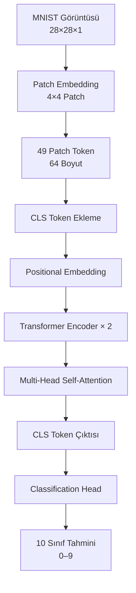
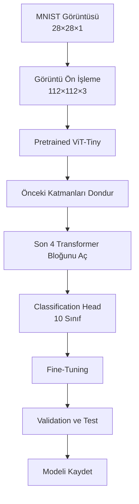

# Vision Transformer (ViT) ile Görüntü Sınıflandırma

Bu projede **PyTorch** kullanarak Vision Transformer (ViT) mimarisini iki farklı yaklaşımla uyguluyoruz:

1. **Sıfırdan Eğitim:** ViT mimarisini kendimiz oluşturup eğitiyoruz.
2. **Fine-Tuning:** Pretrained ViT modelini kendi veri setimize uyarlıyoruz.

Her iki uygulamada **MNIST el yazısı rakam veri seti** kullanılmaktadır.

## 1. Sanal Ortam Oluşturma

Python 3.11 önerilir.

### Windows (PowerShell)

```powershell
python -m venv .env
.\.env\Scripts\Activate.ps1
```

### Windows (CMD)

```bat
python -m venv .env
.env\Scripts\activate.bat
```

### macOS / Linux

```bash
python3 -m venv .env
source .env/bin/activate
```

Sanal ortamı kapatmak için:

```bash
deactivate
```

## 2. Kütüphanelerin Kurulumu

Proje klasöründe `requirements.txt` oluşturun:

```text
torch
torchvision
timm
scikit-learn
```

Kütüphaneleri yükleyin:

```bash
python -m pip install --upgrade pip
pip install -r requirements.txt
```

### Kütüphanelerin Görevleri

| Kütüphane | Açıklama |
|---|---|
| torch | Model oluşturma ve eğitim |
| torchvision | Veri setleri ve görüntü işlemleri |
| timm | Pretrained ViT modelleri |
| scikit-learn | Accuracy ve Confusion Matrix |

Kodlar uygun GPU ortamında GPU, aksi halde CPU kullanır.

## 3. Proje Yapısı

```text
ViT_Projesi/
├── .env/
├── data/
├── requirements.txt
├── vit_sifirdan.py
├── vit_pretrained.py
├── vit_sifirdan.pth
└── vit_pretrained.pth
```

- `.env/`: Python sanal ortamı
- `data/`: Otomatik indirilen MNIST veri seti
- `requirements.txt`: Gerekli kütüphaneler
- `vit_sifirdan.py`: Sıfırdan ViT eğitimi
- `vit_pretrained.py`: Pretrained ViT fine-tuning
- `.pth`: Eğitim sonrasında kaydedilen model ağırlıkları

## 4. Kullanılan Veri Seti: MNIST

MNIST, 0–9 arasındaki el yazısı rakamları içeren bir görüntü sınıflandırma veri setidir.

**Veri Seti Özellikleri**

| Özellik | Değer |
|---|---|
| Görüntü boyutu | 28×28 |
| Kanal | 1 (Gri tonlama) |
| Sınıf sayısı | 10 |
| Toplam görüntü | 70.000 |
| Eğitim | 54.000 |
| Validation | 6.000 |
| Test | 10.000 |

Veri seti `torchvision` üzerinden otomatik indirilir.

Her iki projede aynı eğitim, validation ve test görüntüleri kullanılır. Görüntü ön işleme adımları model gereksinimlerine göre değişebilir.

---

# Proje 1: Sıfırdan ViT Eğitimi

**Dosya:** `vit_sifirdan.py`

## 5. Projenin Amacı

Bu uygulamada hazır model kullanmadan Vision Transformer mimarisini PyTorch ile oluşturuyoruz.

Modelin bütün ağırlıkları başlangıçta rastgele oluşturulur ve MNIST veri seti üzerinden eğitilir.

### Model Parametreleri

| Parametre | Değer | Açıklama |
|---|---|---|
| IMAGE_SIZE | 28 | Görüntü boyutu |
| PATCH_SIZE | 4 | Patch boyutu |
| EMBED_DIM | 64 | Embedding boyutu |
| NUM_HEADS | 4 | Attention başlık sayısı |
| NUM_LAYERS | 2 | Transformer Encoder sayısı |
| NUM_CLASSES | 10 | Rakam sınıfları |
| BATCH_SIZE | 128 | Batch boyutu |
| EPOCHS | 5 | Eğitim turu |
| LEARNING_RATE | 0.0005 | Öğrenme hızı |

## 6. ViT Mimarisi



### Mimari Bileşenleri

**1. Patch Embedding**

28×28 görüntü, 4×4 boyutunda parçalara ayrılır.

Toplam patch sayısı:

`(28 / 4) × (28 / 4) = 49`

Her patch, 64 boyutlu bir embedding vektörüne dönüştürülür.

**2. CLS Token**

Patch token'larının başına öğrenilebilir bir CLS token eklenir.

Bu token, sınıflandırma için görüntünün genel temsilini oluşturur.

**3. Positional Embedding**

Transformer'a patch'lerin görüntüdeki konum bilgisi eklenir.

**4. Transformer Encoder**

İki Transformer Encoder bloğu kullanılır.

Her blokta:
- Multi-Head Self-Attention
- Feed-Forward Network
- Layer Normalization
- Residual Connection

bulunur.

**5. Classification Head**

CLS token çıktısı kullanılarak 10 rakam sınıfı için skorlar oluşturulur.

## 7. Modelin Eğitilmesi

```bash
python vit_sifirdan.py
```

Eğitim sırasında:

- Training Loss
- Training Accuracy
- Validation Accuracy

değerleri görüntülenir.

Validation doğruluğuna göre en iyi model kaydedilir.

**Çıktı:** `vit_sifirdan.pth`

Eğitim tamamlandığında test accuracy ve confusion matrix hesaplanır.

---

# Proje 2: Pretrained ViT Fine-Tuning

**Dosya:** `vit_pretrained.py`

## 8. Projenin Amacı

Bu uygulamada önceden eğitilmiş bir Vision Transformer modelini kullanıyoruz.

Model, ImageNet üzerinde öğrenilmiş görsel özelliklere sahiptir.

MNIST veri setindeki 10 rakam sınıfına uyarlanarak fine-tune edilir.

### Kullanılan Model

`vit_tiny_patch16_224.augreg_in21k_ft_in1k`

Bu model `timm` kütüphanesi üzerinden yüklenir.

### Fine-Tuning Parametreleri

| Parametre | Değer | Açıklama |
|---|---|---|
| IMAGE_SIZE | 112 | Giriş görüntüsü |
| NUM_CLASSES | 10 | Sınıf sayısı |
| TRAINABLE_BLOCKS | 4 | Eğitilen son Transformer blokları |
| BATCH_SIZE | 64 | Batch boyutu |
| EPOCHS | 8 | Eğitim turu |
| LEARNING_RATE | 0.0002 | Öğrenme hızı |

## 9. Fine-Tuning Mimarisi



### Fine-Tuning Adımları

**1. Pretrained Model Yükleme**

ImageNet üzerinde önceden eğitilmiş ViT-Tiny modeli indirilir.

**2. Görüntüleri Hazırlama**

MNIST görüntüleri:
- 112×112 boyutuna dönüştürülür.
- 3 kanallı hale getirilir.
- Normalize edilir.

Pretrained checkpoint'in önerdiği normalizasyon değerlerinin kullanılması tercih edilir.

**3. Katmanları Dondurma**

Modelin önceden öğrenilmiş ağırlıklarının büyük bölümü dondurulur.

`requires_grad = False`

**4. Katmanları Eğitime Açma**

Son 4 Transformer Encoder bloğu, son normalizasyon katmanı ve classification head eğitime açılır.

`requires_grad = True`

**5. Fine-Tuning**

Yalnızca eğitime açık ağırlıklar güncellenir.

Optimizer olarak AdamW, kayıp fonksiyonu olarak CrossEntropyLoss kullanılır.

## 10. Modelin Eğitilmesi

```bash
python vit_pretrained.py
```

İlk çalıştırmada pretrained model ağırlıkları otomatik indirilir.

Eğitim sırasında:

- Training Loss
- Training Accuracy
- Validation Accuracy

değerleri görüntülenir.

Validation doğruluğuna göre en iyi model kaydedilir.

**Çıktı:** `vit_pretrained.pth`

Eğitim tamamlandığında test accuracy ve confusion matrix hesaplanır.

---

## 11. Sıfırdan Eğitim ve Fine-Tuning Farkları

| Özellik | Sıfırdan ViT | Pretrained ViT |
|---|---|---|
| Mimari | Kendimiz oluşturuyoruz | Hazır ViT-Tiny |
| Başlangıç ağırlıkları | Rastgele | ImageNet pretrained |
| Eğitilen katmanlar | Tüm katmanlar | Seçilen son katmanlar |
| Görüntü boyutu | 28×28 | 112×112 |
| Veri seti | MNIST | MNIST |
| Sınıf sayısı | 10 | 10 |
| Kütüphane | PyTorch | PyTorch + timm |

Pretrained modelin daha başarılı olması garanti değildir. MNIST ve ImageNet farklı görüntü dağılımlarına sahiptir.

## 12. Model Sonuçları

Her iki uygulamada aşağıdaki metrikler kullanılır.

**Loss:** Modelin tahmin hatasını ölçer.

**Training Accuracy:** Eğitim verileri üzerindeki sınıflandırma doğruluğudur.

**Validation Accuracy:** Eğitim sırasında ayrılmış doğrulama verileri üzerindeki başarımı gösterir.

**Test Accuracy:** Eğitim tamamlandıktan sonra bağımsız test görüntülerindeki başarımı ölçer.

**Confusion Matrix:** Hangi rakamların hangi rakamlarla karıştırıldığını gösterir.

## 13. Sık Sorulan Sorular

### GPU gerekli mi?

Hayır. Her iki proje CPU üzerinde çalışabilir. Pretrained modelde CPU eğitim süresi daha uzun olabilir.

### Veri setini indirmem gerekiyor mu?

Hayır. MNIST veri seti kod tarafından otomatik indirilir.

### Modeller neden farklı görüntü boyutları kullanıyor?

Sıfırdan oluşturduğumuz model MNIST'in 28×28 çözünürlüğü için tasarlanmıştır.

Pretrained ViT ise üç kanallı görüntüler beklediği için görüntüler yeniden boyutlandırılır.

### Model ağırlıkları nasıl kaydediliyor?

PyTorch `state_dict()` yöntemi kullanılıyor.

```python
torch.save(model.state_dict(), "model.pth")
```

Bu dosyayı yeniden yüklemek için aynı mimari oluşturulmalı ve `load_state_dict()` kullanılmalıdır.

### Keras kullanılıyor mu?

Hayır. Her iki uygulamada da ana framework PyTorch'tur.

---

## Sonuç

Bu iki uygulama sayesinde:

- Vision Transformer mimarisinin temel bileşenlerini öğreniyoruz.
- PyTorch ile sıfırdan ViT modeli oluşturuyoruz.
- Kendi modelimizi sıfırdan eğitiyoruz.
- Pretrained ViT modellerini kullanıyoruz.
- Fine-tuning işlemini uyguluyoruz.
- Eğitim ve test sonuçlarını değerlendiriyoruz.

**Sonraki adım:** DeiT ve Swin Transformer mimarilerini öğrenmek.
